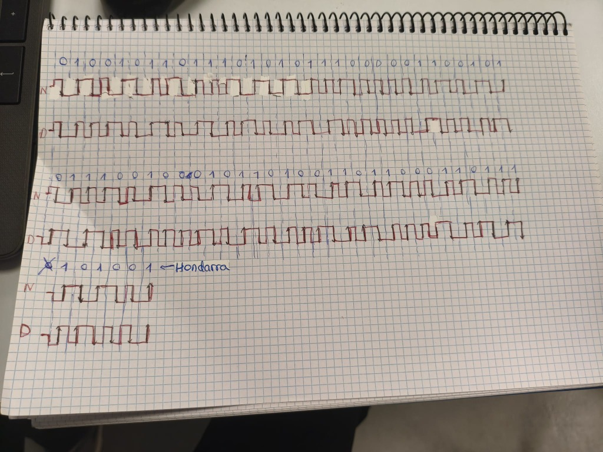

# Sareak: Azpiegitura Fisikoa eta Konektibitatea

Dokumentu honetan sareko gailuak, datuen transmisioa, kableatu egituratua eta sareko konexioak landu ditugu.

## 1. Datu-sareak eta Transmisioa (IE1)

### 1.1. Sareko gailuak eta OSI eredua

OSI ereduaren lehen hiru mailak aztertu ditugu:

| Gailua | OSI maila | Funtzioa |
|---|---|---|
| UTP Cat6, Keystone eta Patch Panela | 1. Fisikoa | Datuak kable bidez transmititzea. |
| Switch-a | 2. Lotura | Datuak MAC helbideen arabera bidaltzea. |
| Sare-txartela (NIC) | 1. eta 2. mailak | Ekipoa sarera konektatzea. |
| Wi-Fi Access Point-a | 1. eta 2. mailak | Wi-Fi gailuak sarera konektatzea. |
| Routerra | 3. Sarea | Sare desberdinen arteko komunikazioa kudeatzea. |

### 1.2. ASCII eta CRC-6-GSM

Zerbitzariko pasahitzaren adibidea `Kuper-67` izan da. Karaktereak ASCII kodearen bidez bit bihurtu ditugu.

| Karakterea | ASCII hamartarra | Bitarra |
|---|---:|---|
| K | 75 | `01001011` |
| u | 117 | `01110101` |
| p | 112 | `01110000` |
| e | 101 | `01100101` |
| r | 114 | `01110010` |
| - | 45 | `00101101` |
| 6 | 54 | `00110110` |
| 7 | 55 | `00110111` |

Datu-sekuentzia osoa 64 bitekoa da.

**CRC-6-GSM polinomioa:**

`G(x) = x⁶ + x⁵ + x³ + x² + x + 1`

Bitarrean: `1101111`

Zatiketa modulo-2 (XOR) egin dugu. Horretarako, mezuaren amaieran sei zero gehitu ditugu.

Lortutako CRC hondarra **`101001`** da. Batzuetan, hasierako zeroa gehituta, `0101001` bezala idatz daiteke, baina CRC-6aren hondarra sei bitekoa da.

Hartzaileak egiaztapena egiten du hondarra zuzena den ikusteko.


### 1.3. Modulazio digitalak

Datuak seinaleen bidez transmititzeko hiru modulazio mota landu ditugu:

- **ASK:** seinalearen anplitudea aldatzen da.
- **FSK:** seinalearen maiztasuna aldatzen da.
- **PSK:** seinalearen fasea aldatzen da.

**Modulazio konbinatua: PSK(2) + ASK(2) + FSK(2)**

Modulazio bakoitzean bi bit erabiliz gero, lau aukera daude bakoitzean. Hiru modulazioak konbinatuta, \(2^6 = 64\) sinbolo desberdin adieraz daitezke.

- ASK: lau anplitude-maila.
- FSK: lau maiztasun.
- PSK: lau fase.


### 1.4. Manchester kodifikazioa

Manchester eta Manchester diferentziala landu ditugu.

**Manchester normala (N):**
- `0`: goitik behera aldatzen da seinalea.
- `1`: behetik gora aldatzen da seinalea.

**Manchester diferentziala (D):**
- Bit bakoitzaren erdian trantsizio bat dago.
- `0`: bitaren hasieran trantsizioa dago.
- `1`: bitaren hasieran ez dago trantsiziorik.

Bi kodifikazioak koadernoan marraztu ditugu, `Kuper-67` mezuarekin eta CRC hondarrarekin.



---

## 2. Kableatu egituratua eta Wi-Fi (IE2)

### 2.1. Kableatuaren instalazioa

UTP Cat6 kablea erabili dugu eta **TIA/EIA-568B** arauaren arabera konektatu dugu.

Koloreen ordena:

1. Zuri-laranja
2. Laranja
3. Zuri-berdea
4. Urdina
5. Zuri-urdina
6. Berdea
7. Zuri-marroia
8. Marroia

**A) Keystone konektorea**

Mahaiko rosetan Keystone konektorea muntatu dugu. Kablearen hariak koloreen arabera kokatu eta inpaktu-tresnarekin finkatu ditugu.


**B) Patch Panela**

Kablearen beste muturra rack-eko Patch Panelaren 18. atakan konektatu dugu, 568B araua jarraituz.


**C) LAN Tester proba**

Kablea LAN Testerrarekin egiaztatu dugu. Hasieran, 3. pina ez zen ondo konektatzen. Berriro finkatu ondoren, 1etik 8rako argiak ordenan piztu ziren.

### 2.2. Sare kableatua eta Wi-Fi

- **Sare kableatua:** zerbitzariari eta ordenagailuei IP helbide estatikoak esleitu dizkiegu.
- **Wi-Fi:** Access Point-a switch-era konektatu dugu.
- **Segurtasuna:** WPA2 enkriptazioa konfiguratu dugu eta mugikorrarekin konexioa probatu dugu.

---

## 3. Switch-a eta konektibitatea (IE3)

### 3.1. Sarearen topologia

Izar-topologia erabili dugu. Switch-a erdian dago eta sareko gailuak bertara konektatzen dira.

```text
[Windows Server] ─────────────┐
                              │
[PC1] ─ [Keystone] ─ [Patch Panel 18]
                              │
                       [SWITCH NAGUSIA]
                              │
                    [Wi-Fi Access Point]
                              )))
                       [Mugikorra]
```

### 3.2. IP helbideen taula

Gailuak `192.168.1.0/24` azpisarean konfiguratu ditugu.
Baina Access Pointa-k gelako ip bat izango du.

| Gailua | IP helbidea | Maskara | Atebidea | DNS |
|---|---|---|---|---|
| Windows Server | `192.168.1.10` | `255.255.255.0` | `192.168.1.1` | `127.0.0.1` |
| Access Point-a | `192.168.70.171` | `255.255.255.0` | `192.168.70.171` | `192.168.70.171` |

### 3.3. Ping probak

Gailuen arteko konexioa egiaztatzeko, `ping` komandoa erabili dugu.

**1. PC1etik zerbitzarira:**

```text
ping 192.168.1.10

Paketeak bidalita: 4
Jasota: 4
Galduta: 0 (%0)
```

**2. Mugikorretik zerbitzarira:**

Mugikorra Wi-Fi sarean konektatuta zegoela, zerbitzariaren konexioa egiaztatu dugu. Lau paketeak behar bezala iritsi ziren, %0ko galerarekin.

Lan honetan sareko oinarrizko kontzeptuak landu ditugu, kableatu fisikoa muntatu dugu eta gailuen arteko konektibitatea egiaztatu dugu.