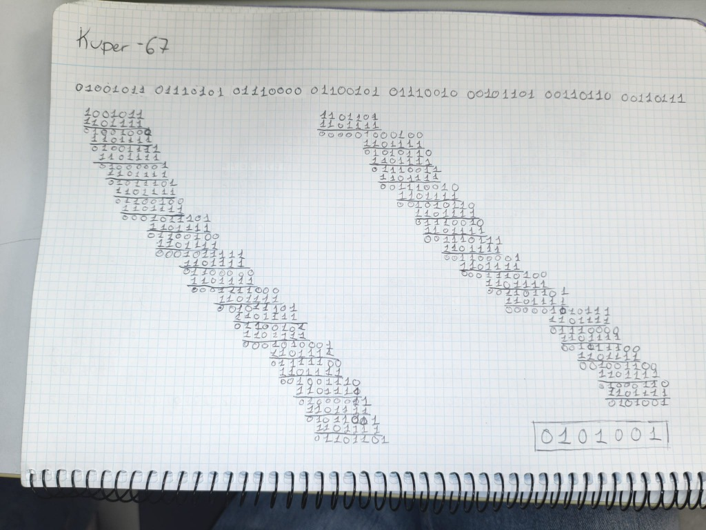
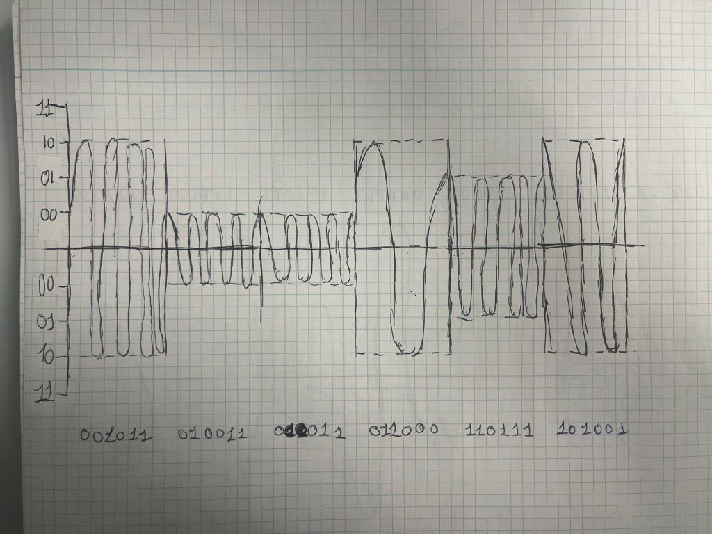
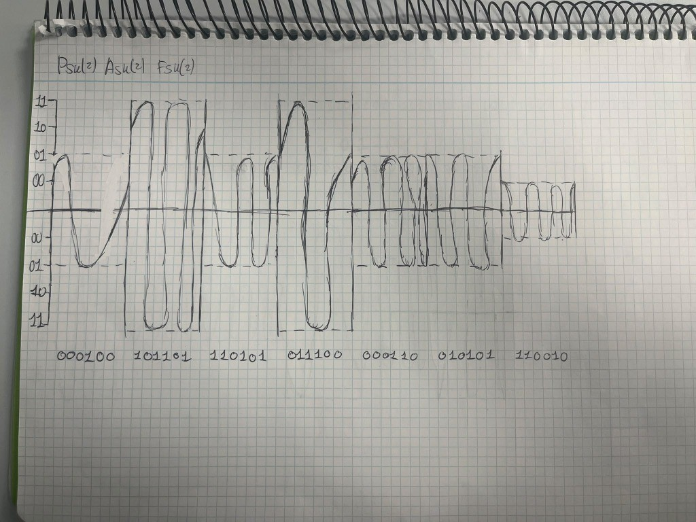
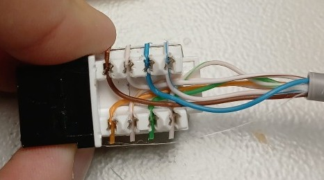
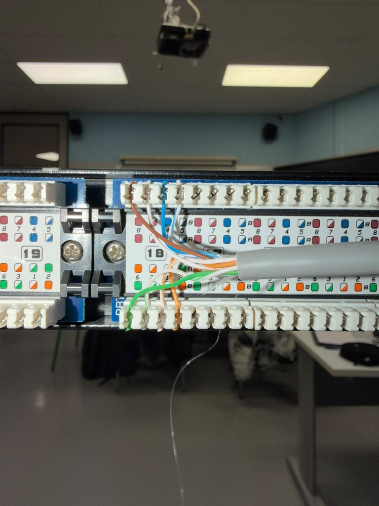

# Sareak - 1. Erronkako Dokumentazioa

**Taldea:** [Zure taldearen izena edo kideak hemen]  
**Data:** 2026ko Urria  
**Modulua:** Sareak Administratzea eta Planifikatzea  

---

## 1. Sarrera

Dokumentu honetan 1. erronkan sareen atalean egin ditugun praktika eta ariketa guztiak azalduko ditugu. Klasean ikasitako teoria (CRC kalkulua, modulazioak, Manchester...) eta tailerrean egindako muntaia praktikoa (kableak moztu eta ziztatu, patch panela, keystone-a, switch-a eta ping probak) batu ditugu hemen.

---

## 2. Datu-sareen Egitura eta Transmisioa (IE1)

### 2.1. Sareko gailuak eta zein mailatan dauden (OSI eredua)

Klasean ikusi dugun bezala, sarean erabiltzen diren gailuak OSI ereduaren arabera maila desberdinetan kokatzen dira:

* **1. Maila (Fisikoa):** Hemen kableak (UTP kablea), Patch Panela eta Keystone konektorea sartzen dira. Seinale elektrikoak eta bitak (0 eta 1) bakarrik garraiatzen dituzte, ez dakite datuek zer esan nahi duten.
* **2. Maila (Lotura):** Switch-a (konmutadorea) eta ekipoen sare-txartelak (NIC). MAC helbideak erabiltzen dituzte jakiteko trama bakoitza zein atakara bidali behar den. Access Point-a (Wi-Fi) ere hemen kokatzen da zubi lana egiten duelako kablearen eta haririk gabeko seinalearen artean.
* **3. Maila (Sarea):** Routerra. IP helbideekin lan egiten du paketeak sare batetik bestera bideratzeko.

---

### 2.2. CRC kalkulua eskuz (Erroreak kontrolatzeko)

Datuak kabletik bidaltzean akatsik dagoen jakiteko CRC metodoa erabili dugu. Gure taldeari egokitu zaion hitza **"Kuper-67"** izan da.

1. **Testua bitetara pasatu:** Lehenengo karaktere bakoitzaren ASCII kodea bilatu dugu eta bitetan jarri dugu (8 bit karaktere bakoitzeko):
   * K = `01001011`
   * u = `01110101`
   * p = `01110000`
   * e = `01100101`
   * r = `01110010`
   * \- = `00101101`
   * 6 = `00110110`
   * 7 = `00110111`
   
   Denak batera jarrita 64 biteko kate luze bat geratzen da.

2. **Polinomio zatitzailea:** Ariketan emandako polinomioa `1101111` zen (7 bit ditu). Polinomioak 7 bit dituenez, mezuaren atzean **6 zero** gehitu behar dira (`000000`) zatiketarekin hasi aurretik.

3. **Zatiketa (XOR):** Koadernoan zatiketa bitarra egin dugu XOR erabiliz (zenbaki berdinak badira 0 jartzen da, eta desberdinak badira 1). Beheko irudian ikusten den bezala, orri osoa bete dugu zatiketarekin eta azkenean hondarra **`0101001`** atera zaigu.



Hondar hori (`0101001`) da mezuaren bukaeran itsatsita bidaltzen dena, eta jasotzen duenak berriro zatiketa eginda `000000` atera behar zaio dena ondo dagoela ziurtatzeko.

---

### 2.3. Modulazioak: ASK, PSK, FSK (eta konbinatua)

Seinale analogiko baten bidez bitak bidaltzeko hiru modu daude:
* **ASK:** Altuera edo anplitudea aldatzen da bitaren arabera.
* **FSK:** Maiztasuna aldatzen da (uhinak azkarrago edo motelago doaz).
* **PSK:** Fasea aldatzen da (uhina nondik hasten den: 0º, 90º, 180º edo 270º).

Guk ariketan modulazio konbinatua egin dugu: **`PSK(2) ASK(2) FSK(2)`**. Horrek esan nahi du sinbolo bakoitzean 6 bit sartzen direla aldi berean (2 bit PSK-rentzat, 2 bit ASK-rentzat eta 2 bit FSK-rentzat). Beraz, $2^6 = 64$ aldaketa desberdin egin daitezke!

* ASK-n 4 tentsio maila jarri ditugu ardatzean (`00`, `01`, `10`, `11`).
* FSK-n maiztasuna aldatu dugu (ziklo gehiago edo gutxiago marraztuz tarte bakoitzean).
* PSK-n uhina goitik edo azpitik hasi dugu fasearen arabera.

Hemen daude koadernoan marraztutako grafikoak (nahiko zaila izan zen dena koadroetan ondo koadratzea!):





---

### 2.4. Manchester kodifikazioa

Ethernet kableetan seinalea bidaltzeko Manchester kodifikazioa erabiltzen da. Klasean ikusi dugun bezala, teknika honek bit bakoitzaren erdian beti egiten du tentsio-aldaketa bat (trantsizioa):
* **0 denean:** Goitik behera jaisten da seinalea.
* **1 denean:** Behetik gora igotzen da seinalea.

Honi esker hargailuak ez du inoiz erlojuaren denbora galtzen, nahiz eta jarraian '0' edo '1' asko bidali.

---

## 3. Sare Kableatua eta Wi-Fia (IE2)

### 3.1. Kableak egitea eta konexioak (Keystone eta Patch Panela)

Praktikan kableatu egituratuaren atala muntatu dugu tailerrean. UTP Cat6 kable zuria erabili dugu eta **TIA/EIA-568B** araua jarraitu dugu kableen koloreak ordenatzeko:
1. Zuri-Laranja
2. Laranja
3. Zuri-Berdea
4. Urdina
5. Zuri-Urdina
6. Berdea
7. Zuri-Marroia
8. Marroia

#### Keystone konektorea (Roseta emea):
Mahaian geratzen den muturrean Keystone eme bat jarri dugu:
* Kablearen kanpoko plastikoa kontu handiz zuritu dugu barruko hariak ez hausteko.
* Bikote bakoitza bere lekuan sartu dugu keystone-an agertzen den B koloreen gida jarraituz.
* Inpaktagailuarekin (Krone estiloko tresna horiarekin) bultzatu dugu hariak ondo kontaktua egiteko eta muturretan soberan geratzen zen kablea ebakitzeko.



#### Patch Panela (Rack-ean):
Beste muturra rack-era eraman dugu eta 18. atakan konektatu dugu:
* Atzeko aldean kableak koloreen arabera jarri ditugu berriro (laranja, berdea, urdina eta marroia).
* Inpaktatzeko tresnarekin ziztatu ditugu ataka bakoitzean ondo finkatuta gera daitezen.



*Proba testerrarekin:* Kablea amaitu genuenean LAN testerrarekin probatu genuen. Hasieran 3. pina ez zen pizten haria ez zelako ondo sartu, baina inpaktagailuarekin berriro estutu ondoren 1etik 8ra argi guztiak ordenan eta berdez piztu ziren.

---

### 3.2. Sare-txartelak eta Haririk gabeko sarea (Wi-Fi)

Ekipo guztiek komunikatu ahal izateko IP helbide estatikoak konfiguratu ditugu:
* Windows Serverrean eta gure ordenagailuetan IPv4 propietateetan sartu eta eskuz jarri dugu IPa eta maskara (`255.255.255.0`).
* Horrez gain, Access Point (AP) bat konektatu dugu switch-era. Wi-Fi sare bat sortu dugu WPA2 pasahitzarekin eta mugikorrarekin konektatu gara sare berean egoteko.

---

## 4. Switch-a eta Konektibitatea (IE3)

### 4.1. Sarearen eskema eta IP taula

Muntaia izar erakoa da: Switch-a erdian dago, eta bertara konektatzen dira patch paneletik datorren kablea (gure mahaiko PCra doana), zerbitzaria eta Wi-Fi puntua.

```text
[Windows Server] ──(kablea)──┐
                             │
[Gure PCa] ──[Keystone]──[Patch Panel]──> [ SWITCH-A ] <──(kablea)── [AP Wi-Fi]
                                                                        :  (wifi)
                                                                        v
                                                                   [Mugikorra]
```

Klasean erabili ditugun IP helbideak:

| Gailua | Nola konektatzen da | IP Helbidea | Maskara | Atebidea (Gateway) |
| :--- | :--- | :--- | :--- | :--- |
| **Windows Server** | Kablez switch-era | `192.168.1.10` | `255.255.255.0` | `192.168.1.1` |
| **PC1 (Gure ordenagailua)** | Keystone bidez | `192.168.1.20` | `255.255.255.0` | `192.168.1.1` |
| **Wi-Fi Access Point** | Kablez switch-era | `192.168.1.2` | `255.255.255.0` | `192.168.1.1` |
| **Mugikorra / Eramangarria**| Wi-Fi bidez | `192.168.1.50` | `255.255.255.0` | `192.168.1.1` |

---

### 4.2. Ping probak (Dena ondo dabilela baieztatzeko)

Errubrikan eskatzen den bezala, edozein gailutatik edozein gailura ping-a probatu dugu konektibitatea egiaztatzeko:

#### 1. Gure PCtik Zerbitzarira:
Terminalean `ping 192.168.1.10` jarri dugu:
```text
C:\Users\Ikaslea> ping 192.168.1.10

Haciendo ping a 192.168.1.10 con 32 bytes de datos:
Respuesta desde 192.168.1.10: bytes=32 tiempo<1m TTL=128
Respuesta desde 192.168.1.10: bytes=32 tiempo<1m TTL=128
Respuesta desde 192.168.1.10: bytes=32 tiempo<1m TTL=128
Respuesta desde 192.168.1.10: bytes=32 tiempo<1m TTL=128

Estadísticas de ping para 192.168.1.10:
    Paquetes: enviados = 4, recibidos = 4, perdidos = 0 (0% perdidos)
```
Denak erantzun du eta ez da paketerik galdu.

#### 2. Zerbitzaritik gure PCra:
Zerbitzariaren makinatik kontrako bidea probatu dugu:
```text
PS C:\Users\Administrator> ping 192.168.1.20
Respuesta desde 192.168.1.20: bytes=32 tiempo<1m TTL=128
Paquetes: enviados = 4, recibidos = 4, perdidos = 0 (0% perdidos)
```

#### 3. Mugikorretik (Wifitik) Zerbitzarira:
Mugikorra wifira konektatuta zegoela ping aplikazio batekin probatu dugu zerbitzariaren IPra (`192.168.1.10`) eta 4 paketeak ondo iritsi dira (denbora 2-3 ms ingurukoa izan da wifian pixka bat gehiago tardatzen duelako, baina %0 galdu da).

---

## 5. Laburpena

Praktika honetan sare baten alderdi teorikoak eta fisikoak landu ditugu. CRC kalkulua koadernoan egitea luzea izan zen baina azkenean hondarra ondo atera zen. Tailerrean kableak ziztatzen ikasi dugu keystone eta patch panelean, eta testerrarekin ikusi dugu dena ondo zegoela. Bukatzeko switch-a eta wifia lotu ditugu eta ping proba guztiek ondo erantzun dute.
