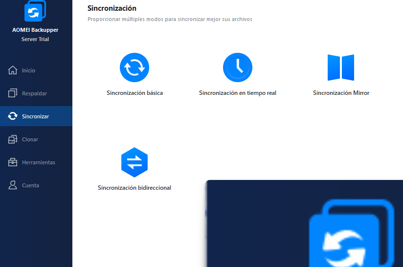
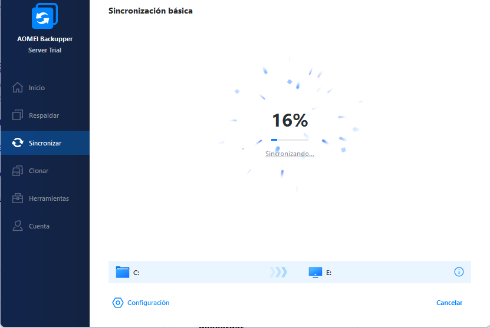
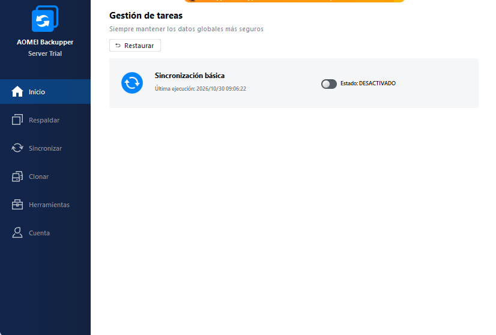
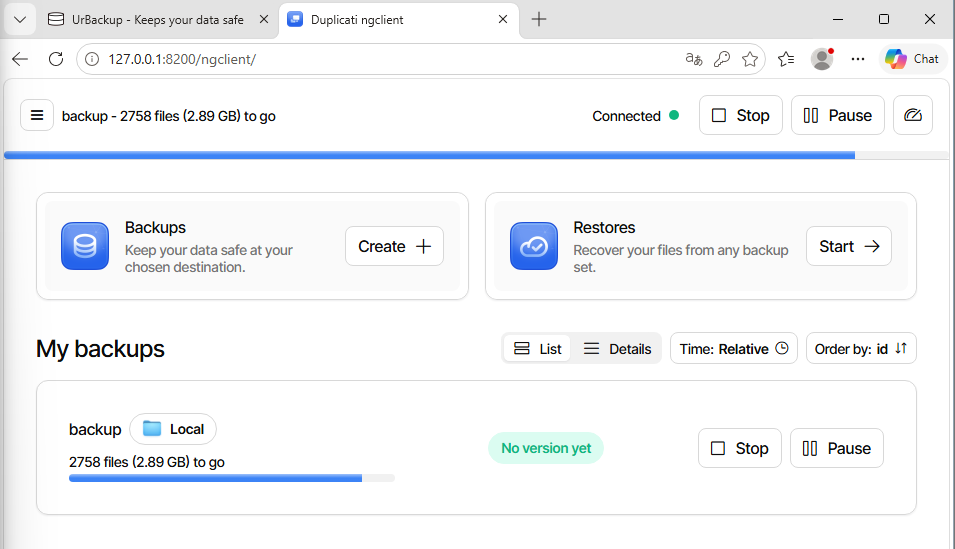
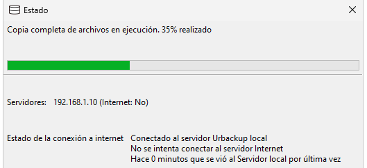

# Sistema Eragileen Ezartzea (SISA 1) - 1. Erronka: Sareflix

**Ikaslea:** Alex Sierra  
**Taldekideak:** Alex, Axular, Iker, Jokin  
**Maila:** ASIR 1. maila (2026-2027)  
**Sistema:** Windows Server 2022 Standard (VirtualBox bidez)  

---

## Sarrera
Erronka honetan niri zerbitzariaren zatia egitea egokitu zait: Windows Server 2022 instalatu, sarean konfiguratu, erabiltzaileak eta segurtasuna kudeatu, IIS bidez webgunea argitaratu, eta diskoetan RAIDak zein babeskopiak prestatzea datuak ez galtzeko.

Hemen azalduta uzten dut nola egin dudan dena pausoz pauso, irakasleak eskatutako irizpideak betez eta gure taldeko orrira erraz gehitzeko moduan.

---

## 1. Makina Birtuala eta Windows Server 2022 Instalazioa (IE1)

### 1.1 Makina Birtualaren Prestaketa (VirtualBox)
Zerbitzaria muntatzeko **Oracle VM VirtualBox** erabili dut:
- **Sistema Eragilea:** Windows Server 2022 Standard (Desktop Experience, hau da, interfaze grafikoarekin).
- **Baliabideak:** 2 vCPU eta 4 GB RAM jarri dizkiot ondo ibil dadin.
- **Guest Additions:** `VBox_GAs_7.2.16` instalatu dut pantaila ondo doitzeko eta fitxategiak errazago pasatzeko.
- **Diskoak:**
  - **Disko nagusia (Disko 0):** 120 GB-ko disko finkoa sistema eragilearentzat eta programentzat.
  - **Disko osagarriak:** Beste 5 disko birtual gehitu dizkiot makina birtualari (bakoitza 5 GB ingurukoa), gero RAID 1 eta RAID 5 egiturekin praktikatzeko.

### 1.2 Zerbitzariaren Oinarrizko Ezarpenak eta Sarea
Instalazioa amaitu ondoren, Server Manager-etik oinarrizko datuak konfiguratu ditut zerbitzaria prest uzteko:
- **Ekipoaren izena (Hostname):** `WIN-LGOQ4MVHH95`
- **Lan-taldea:** `WORKGROUP`
- **IP Helbidea (Ethernet):** `192.168.70.21` (IP finkoa jarri diot, zerbitzari batek ezin duelako IPa aldatzen ibili bezeroak ez galtzeko).
- **Urrutiko Kudeaketa eta Mahaigaina (RDP):** Gaituta utzi ditut, zerbitzaria urrunetik kudeatu ahal izateko.
- **Windows Defender Firewall:** Profil publikoan aktibatuta dago.

*1. Irudia: Zerbitzariaren datu orokorrak eta IP helbidea (192.168.70.21).*

### 1.3 Eguneraketak eta Instantanea (Snapshot)
- **Windows Update:** Eguneraketa guztiak deskargatu eta instalatu ditut sistema seguru edukitzeko.
- **Instantanea VirtualBox-en:** Behin sistema garbi eta eguneratuta edukita, makina itzali eta snapshot bat atera dut. Horrela zerbait apurtzen badut probak egiterakoan, segundotan hasierako egoera garbi horretara itzul naiteke.

---

## 2. Erabiltzaileak, Segurtasun Politikak eta IIS Web Zerbitzaria (IE2)

### 2.1 Erabiltzaileak eta Taldeak (`lusrmgr.msc`)
Ez dugu administratzaile kontu orokorra erabili behar lan arruntetarako. Horregatik, `lusrmgr.msc` ireki eta erabiltzaileak banan-banan sortu ditut:
- **Taldekideen erabiltzaileak:** `Alex`, `Axular`, `Iker` eta `Jokin` (bakoitzak bere erabiltzaile propioa izateko).
- **Probetarako kontuak:** `Misteraura` eta `Negligencia` sortu ditut baimenak eta mugak frogatzeko.
- **Administratzailea:** Berez datorren kontua kudeaketa nagusirako bakarrik utzita.

*2. Irudia: Sortutako erabiltzaile lokalak.*

Taldeei dagokienez, erabiltzaileak banaka kudeatu beharrean taldeen bidez antolatzea askoz eraginkorragoa denez, bi talde nagusi sortu ditut Sareflix plataformarako:
- **`erabiltzaileak`**: Zerbitzuko bezero arrunten taldea.
- **`premium erabiltzaileak`**: Harpidetza berezia duten bezeroen taldea, baimen gehiagorekin.

*3. Irudia: Erabiltzaileak eta Premium Erabiltzaileak taldeak.*

### 2.2 Segurtasun eta Pasahitz Politikak (`secpol.msc`)
Zibersegurtasuna zaintzeko eta inork pasahitz txarrak ez jartzeko, Tokiko Segurtasun Politikak konfiguratu ditut:

#### Pasahitz Direktibak:
- **Konplexutasuna (Requisitos de complejidad):** `Habilitada`. Nahitaezkoa da maiuskulak, minuskulak eta zenbakiak nahastea.
- **Gutxieneko luzera:** `8 karaktere`. Ezin da 8 karaktere baino gutxiagoko pasahitzik jarri.
- **Gehienezko adina (Vigencia máxima):** `90 egun` (3 hilabetero pasahitza berritzera behartzeko).
- **Gutxieneko adina:** `0 egun`.
- **Cifrado reversible:** `Deshabilitada` segurtasunagatik.

*4. Irudia: Directiva de contraseñas ezarpenak secpol.msc kontsolan.*

#### Kontu Blokeo Direktibak (Account Lockout):
Indar gordineko erasoak (brute force) mozteko:
- **Blokeo atalasea (Umbral de bloqueo):** `5 saiakera oker`. Norbaitek pasahitza 5 aldiz gaizki sartzen badu, kontua blokeatu egiten da.
- **Blokeoaren iraupena (Duración del bloqueo):** `15 minutu` egongo da blokeatuta.
- **Kontagailua berrezartzea:** `10 minutu` pasa ondoren kontagailua zerora itzultzen da.
- **Administratzailea blokeatzea:** `Habilitada` utzi dut segurtasun handiagoa izateko.

*5. Irudia: Kontuen blokeo direktibak secpol.msc-n.*

### 2.3 Sareak Moduluarekiko Integrazioa
Sareak moduluko ariketan pasahitz bat eskatu ziguten kabletik bidaltzeko. Gure zerbitzariko pasahitz politikekin bat datorren pasahitz seguru bat aukeratu genuen. Pasahitz hori hartuta:
1. ASCII kodifikaziora pasa zuten sareetako kideek bitak lortzeko.
2. CRC-6-GSM polinomiotik ($x^6 + x^5 + x^3 + x^2 + x + 1$) pasa zuten erroreen kontrola egiteko.
3. Modulazio desberdinetan (ASK, FSK, PSK) eta Manchester kodifikazioan marraztu zuten seinalea.

### 2.4 IIS Web Zerbitzaria eta `intranet` Gunea (Portua: 8080)
Sareflix-eko edukia zerbitzatzeko Windowsen dakarren **IIS (Internet Information Services)** erabili dut:
1. Zerbitzarian IIS rola gehitu nuen.
2. IIS kudeatzailean (`inetmgr`) gune berri bat sortu nuen: **`intranet`**.
3. Ataka/Portua: **`8080`** portuan konfiguratu nuen (`Examinar *:8080 (http)`).
4. Webguneko fitxategiak (`index.html`, estiloak eta irudiak) bertara lotu nituen.
5. **Suebakia (Firewall):** Portu horretatik trafikoa pasa ahal izateko, Windows Defender Firewall-ean sarrerako araua gehitu nuen 8080 atakarako.
6. **Egiaztapena:** Sare berean dagoen beste gailu batetik (edo mugikorretik Wi-Fi bidez) nabigatzailean `http://192.168.70.21:8080/` jarrita, Sareflix-en orria zuzenean kargatzen da.

*6. Irudia: IIS kontsolan sortutako 'intranet' gunea 8080 atakan entzuten.*

---

## 3. Diskoen Kudeaketa, RAIDak eta Babeskopiak (IE3)

### 3.1 Diskoak Dinamiko Bihurtzea eta Partizioak (`diskmgmt.msc`)
Diskoen kudeatzailean (`diskmgmt.msc`) sartu eta ikusi daiteke nola banatu ditudan diskoak:
- **Disko 0 (120 GB, Básiko):** Sistema eragilearentzat bakarrik.
  - 100 MB sistema partizioa.
  - C: partizioa (119,33 GB) Windows Serverrekin.
  - 584 MB berreskuratze partizioa.
- **Beste 5 diskoak (Disko 1etik Disko 5era):** Bakoitzak 4,98 GB ditu. Horiek guztiak **Dinamiko** bihurtu nituen, Windowsek RAIDak sortzen utz diezagun.

*7. Irudia: Administrador de discos: Disko 0 basikoa, Disko 1-2 RAID 1ean eta Disko 3-4-5 RAID 5ean.*

### 3.2 RAID 1 (Ispilua - Volumen Reflejado)
- **Erabilitako diskoak:** Disco 1 eta Disco 2 (4,98 GB bakoitza).
- **Mota:** Ispilua (RAID 1).
- **Edukiera:** `4,98 GB` erabilgarri (disko baten tamaina).
- **Letra:** `E:` unitatea (`raid1` izenarekin).
- **Zertarako balio du?** Datuak bi diskoetan batera kopiatzen dira. Disko bat fisikoki apurtzen bada, besteak berdin-berdin jarraitzen du lanean daturik galdu gabe.

### 3.3 RAID 5 (Paritatea)
- **Erabilitako diskoak:** Disco 3, Disco 4 eta Disco 5 (3 disko dinamiko, 4,98 GB bakoitza).
- **Mota:** RAID-5 bolumena.
- **Edukiera Erabilgarria:**
  $$\text{Tamaina erabilgarria} = (N - 1) \times S = (3 - 1) \times 4,98\text{ GB} = \mathbf{9,96\text{ GB}}$$
  Guztira 15 GB gordinetatik ia 10 GB geratzen zaizkigu datuetarako, eta beste 5 GB paritateko informazioarentzat dira.
- **Hutsegite tolerantzia:** Disko bat deskonektatzen badugu (edo hausten bada), bolumena "Degradatua" moduan geratzen da baina sistemak funtzionatzen jarraitzen du, galdutako datuak beste bi diskoetako informazioa eta paritatea erabiliz kalkulatzen dituelako. Gero disko berri bat sartu eta "Reparar volumen" emanda berriro osasuntsu geratzen da.

### 3.4 Disko-Kuotak Erabiltzaileentzat (NTFS Quotas)
Erabiltzaile batek diskoa fitxategiz ez betetzeko, disko-kuotak aktibatu ditut bolumenaren propietateetan (*Propiedades → Cuota*):
- *Habilitar la administración de cuotas* markatu dut.
- *Denegar espacio de disco a usuarios que superen el límite* gaitu dut (muga pasatuz gero ezin dute fitxategi gehiago gorde).
- Muga bat eta abisu-maila bat jarri dizkiot, eta gertaeren erregistroan abisua uzteko aukera aktibatu dut.

---

### 3.5 Babeskopiak Tresna Natiboarekin (Windows Server Backup)
RAIDak hardware akatsetatik babesten du, baina norbaitek artxiboak nahita edo nahi gabe ezabatzen baditu, babeskopia bat behar da. Horretarako lehenik **Windows Server Backup** erabili dut:

- **Eginbidea:** Copia de seguridad de Windows Server instalatu nuen Server Managerretik.
- **Programazioa:** Egunero goizeko **9:00etan** egiten da automatikoki.
- **Zer gordetzen du?** Reconstrucción completa (Bare-Metal) eta Estado del sistema (System state), VSS copia completa bidez.
- **Helmuga:** Babeskopietarako disko dedikatu bat erabili dut (`WIN-LGO 2026_10_28 10:42 DISK_01`), **59,86 GB**-ko tamainakoa.

*8. Irudia: Egunero 9:00etan programatutako babeskopia osoa.*

*9. Irudia: Babeskopietarako erabilitako 59,86 GB-ko disko espezifikoa.*

---

### 3.6 Fitxategien Babeskopiak Hirugarrenen Tresnekin (AOMEI Backupper eta Duplicati)
Errubrikan eskatzen denez hirugarrenen tresnak ere erabiltzea, fitxategien segurtasuna bermatzeko bi aplikazio probatu ditut:

#### A. AOMEI Backupper Server (Sinkronizazioa eta Fitxategi Kopiak)
AOMEI Backupper erabili dut fitxategiak eta karpetak beste unitate batera sinkronizatzeko:
- **Sinkronizazio motak:** Programak lau modu eskaintzen ditu: *Sincronización básica*, *Sincronización en tiempo real*, *Sincronización Mirror* eta *Sincronización bidireccional*.
- **Egindako zeregina:** `Sincronización básica` bat konfiguratu dut `C:` diskoko fitxategi garrantzitsuak `E:` (RAID 1) bolumenera automatikoki pasatzeko. Horrela C: diskoan fitxategi bat aldatzen denean, RAID 1ean kopiatuta geratzen da.
- **Zereginen kudeaketa:** *Gestión de tareas* atalean egiaztatu dut sinkronizazioa arrakastaz burutu dela (09:06:22 exekuzioarekin).

*10. Irudia: AOMEI Backupper-eko sinkronizazio aukerak.*

*11. Irudia: C: diskotik E: (RAID 1) unitatera fitxategiak sinkronizatzen.*

*12. Irudia: Sincronización básica zeregina eginda AOMEIren zereginen kudeatzailean.*

#### B. Duplicati (Fitxategi Kopiak Zifratuarekin)
Fitxategien segurtasun-kopietarako **Duplicati** aplikazioa erabili dut:
- Web nabigatzaile bidez kudeatzen da `http://127.0.0.1:8200/ngclient/` helbidean (Duplicati ngclient interfaze modernoarekin).
- Tokiko babeskopia zeregin bat konfiguratu dut (`backup` izenekoa, helmuga: `Local`). Irudian ikusten denez, 2.758 fitxategiren (2,89 GB guztira) kopia osoa burutzen ari da atzeko planoan.
- Konpresioa eta **AES-256 zifratzea** erabiltzen dituenez, datuak guztiz babestuta geratzen dira.
- Bertsio-kudeaketa (versioning) du, eta behar izanez gero fitxategiak berreskuratzea oso erraza da *Restores (Start ->)* botoia sakatuta.

*13. Irudia: Duplicati ngclient web interfazea (8200 portua) eta tokiko babeskopia martxan (2.758 fitxategi, 2,89 GB).*

---

### 3.7 Diskoaren Irudiak (Copias de Seguridad de Imagen de Disco - 2 Tresna)
Errubrikaren atal honetan eskatzen zen disko osoaren irudia sortzea gutxienez **2 tresna desberdinekin**:

#### 1. Tresna: AOMEI Backupper (Diskoaren eta Sistemaren Irudia)
- AOMEI Backupper barruko *Respaldar* atalean, **Copia de seguridad del sistema** eta **Copia de seguridad de disco** erabili ditut.
- Funtzio honek C: disko osoaren sektorez sektoreko irudi fitxategi bat sortzen du (`.adi` formatuan).
- **Zertarako balio du?** Zerbitzariaren disko nagusiak huts egingo balu, irudi hau erabiliz sistema eragile osoa, programak eta konfigurazioak minutu gutxitan berrezarri daitezke disko berri batean.

#### 2. Tresna: UrBackup (Sareko Irudiak eta Admin Kudeaketa)
- UrBackup bezero-zerbitzari arkitekturan oinarritutako irudi-tresna indartsua da.
- **Admin kontua:** UrBackup-en web interfazean (*UrBackup - Keeps your data safe*) **`admin`** kontua sortu dut zerbitzariaren sarbidea eta konfigurazioa babesteko.
- **Zerbitzaria eta Sarea:** Zerbitzari lokala sareko `192.168.1.10` IP helbidean dago kokatuta. Gure Windows Serverreko UrBackup bezeroa bertara konektatu da zuzenean sare lokaletik (Interneteko konexiorik gabe).
- **Diskoaren Irudia eta Kopia Osoa:** Bezeroak kopia osoa abiatu du automatikoki (*Copia completa en ejecución. 35% realizado*), zerbitzari nagusira diskoaren bloke guztiak eta fitxategiak transferituz.
- **Abantaila nagusia:** Irudia sare bidez gordetzen denez, zerbitzaria guztiz hondatuko balitz ere, UrBackup-eko Restore CD edo USB baten bidez makina berri batera saretik zuzenean irauli dezakegu diskoaren irudia.

*14. Irudia: UrBackup bezeroaren egoera-leihoa: 192.168.1.10 zerbitzari lokalera konektatuta eta kopia osoa exekutatzen (%35).*

---

### 3.8 Berreskuratze Plana (Disaster Recovery Plan - DRP)
Zerbitzarian arazoren bat egonez gero nola jokatu:

1. **RAIDeko disko bat apurtzen bada:** Makina ez da gelditzen; disko berria jarri eta *diskmgmt.msc*-tik birsinkronizatzen da.
2. **Webguneko fitxategi batzuk ustekabean ezabatzen badira:** Duplicati edo AOMEI bidez fitxategien azken bertsioa berreskuratzen dugu segundotan.
3. **Disko nagusia erretzen bada edo sistema abiarazten ez bada:**
   - Aukera 1: **Windows Server Backup**-eko Bare-Metal irudia kargatu instalazio ISOtik (*Reparar equipo*).
   - Aukera 2: **AOMEI Backupper** erreskate-ingurunea erabiliz diskoaren irudia leheneratu.
   - Aukera 3: **UrBackup** bidez saretik egindako disko-irudia berrezarri makina berrian.

---

## 4. Izandako Gorabeherak eta Nola Konpondu Ditudan

1. **RAID 5 aukera ez zen agertzen diskoan:**  
   *Arazoa:* Eskuineko klika egitean ezin nuen RAID 5 sortu.  
   *Konponbidea:* Konturatu nintzen diskoak Básikoak zirela; denak Dinamiko bihurtu nituen eta berehala utzi zidan.

2. **Beste ordenagailutik ezin nintzen webgunera konektatu:**  
   *Arazoa:* IPa eta 8080 portua jarrita kargatzen geratzen zen.  
   *Konponbidea:* Windows Defender suebakiak blokeatzen zuen. Arau berri bat sortu nuen 8080 portua TCPn irekitzeko.

3. **Pasahitza aldatzean errorea ematen zuen:**  
   *Arazoa:* Proba bat egiteko `1234` pasahitza jarri nahi nion erabiltzaile bati eta ez zidan uzten.  
   *Konponbidea:* `secpol.msc` politikek 8 karaktere eta konplexutasuna behartzen zutelako zen. Arauak betetzen zituen pasahitza jarri nion eta primeran ibili zen.

4. **AOMEI sinkronizazioan helmugako unitatea aukeratzea:**  
   *Arazoa:* C: diskoko datuak non gorde pentsatzean, unitate seguru bat behar zen.  
   *Konponbidea:* Guk sortutako `E:` (RAID 1 ispilatua) unitatea aukeratu genuen; horrela kopiatutako fitxategiak bi disko fisikotan bikoiztuta geratzen dira aldi berean.
