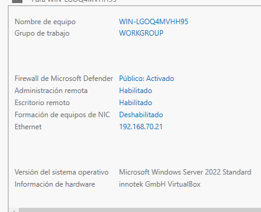
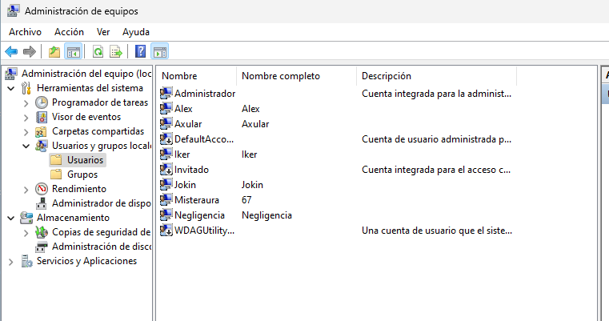
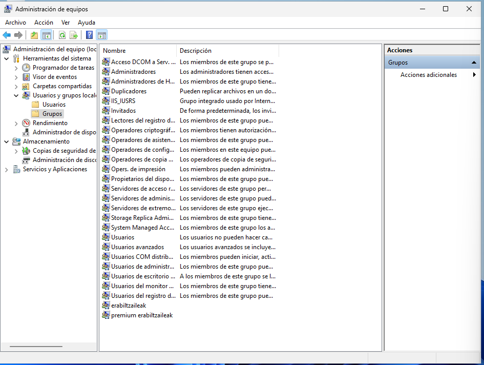
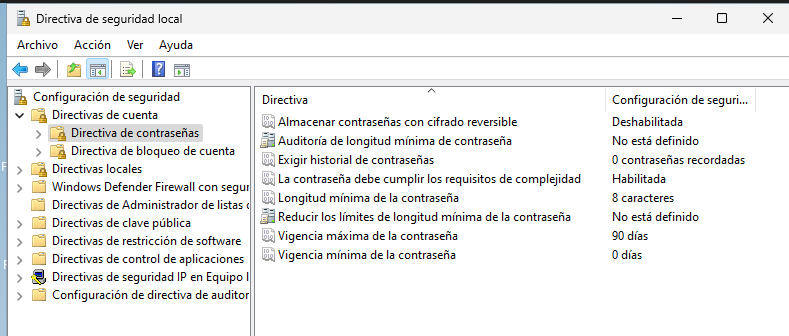
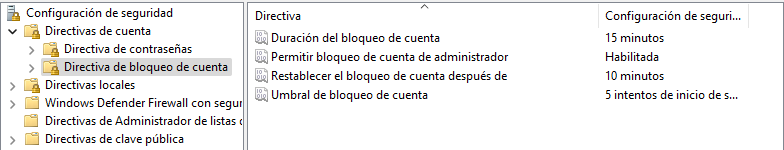
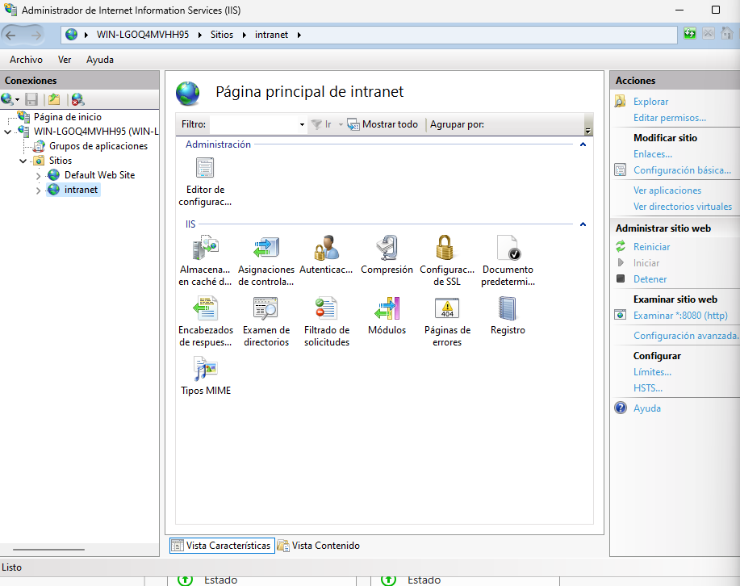
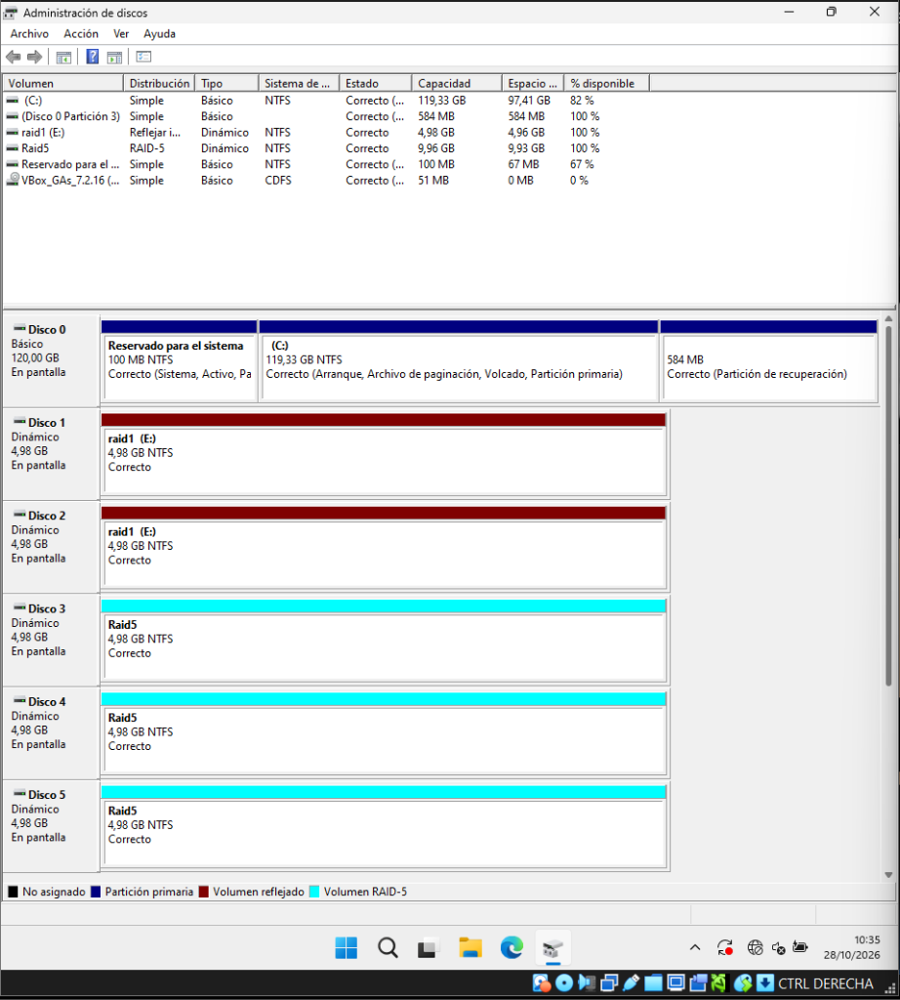
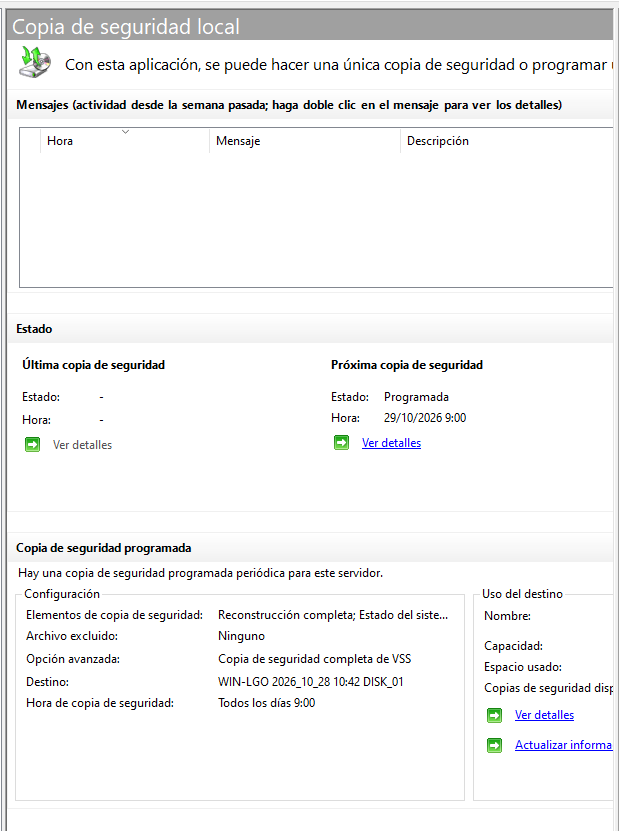
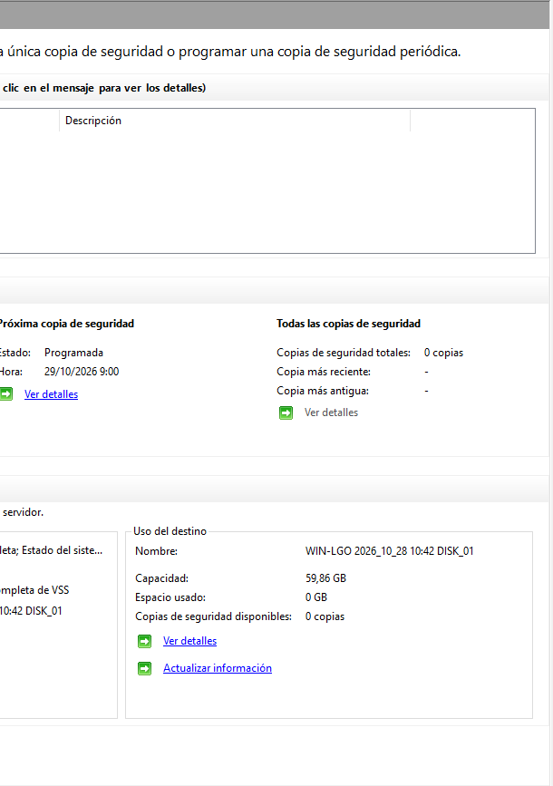

# Sistema Eragileen Ezartzea (SISA 1)

---

## Sarrera

Erronka honetan niri zerbitzariaren zatia egitea egokitu zait: Windows Server 2022 instalatu, sarean konfiguratu, erabiltzaileak eta segurtasuna kudeatu, IIS bidez webgunea argitaratu, eta diskoetan RAIDak zein babeskopiak prestatzea datuak ez galtzeko.

Hemen azalduta uzten dut nola egin dudan dena pausoz pauso, irakasleak eskatutako irizpideak betez eta gure taldeko orrira erraz gehitzeko moduan.

---

## 1. Makina Birtuala eta Windows Server 2022 Instalazioa (IE1)

### 1.1 Makina Birtualaren Prestaketa (VirtualBox)

Zerbitzaria muntatzeko **Oracle VM VirtualBox** erabili dut:

- **Sistema Eragilea:** Windows Server 2022 Standard (Desktop Experience, hau da, interfaze grafikoarekin).
- **Baliabideak:** 2 vCPU eta 4 GB RAM jarri dizkiot ondo ibil dadin.
- **Guest Additions:** `VBox_GAs_7.2.16` instalatu dut pantaila ondo doitzeko eta fitxategiak errazago pasatzeko.
- **Diskoak:**
  - **Disko nagusia (Disko 0):** 120 GB-ko disko finkoa sistema eragilearentzat eta programentzat.
  - **Disko osagarriak:** Beste 5 disko birtual gehitu dizkiot makina birtualari (bakoitza 5 GB ingurukoa), gero RAID 1 eta RAID 5 egiturekin praktikatzeko.

### 1.2 Zerbitzariaren Oinarrizko Ezarpenak eta Sarea

Instalazioa amaitu ondoren, Server Manager-etik oinarrizko datuak konfiguratu ditut zerbitzaria prest uzteko:

- **Ekipoaren izena (Hostname):** `WIN-LGOQ4MVHH95`
- **Lan-taldea:** `WORKGROUP`
- **IP Helbidea (Ethernet):** `192.168.70.21` (IP finkoa jarri diot, zerbitzari batek ezin duelako IPa aldatzen ibili bezeroak ez galtzeko).
- **Urrutiko Kudeaketa eta Mahaigaina (RDP):** Gaituta utzi ditut, zerbitzaria urrunetik kudeatu ahal izateko.
- **Windows Defender Firewall:** Profil publikoan aktibatuta dago.

### 1.3 Eguneraketak eta Instantanea (Snapshot)

- **Windows Update:** Eguneraketa guztiak deskargatu eta instalatu ditut sistema seguru edukitzeko.
- **Instantanea VirtualBox-en:** Behin sistema garbi eta eguneratuta edukita, makina itzali eta snapshot bat atera dut. Horrela zerbait apurtzen badut probak egiterakoan, segundotan hasierako egoera garbi horretara itzul naiteke.

---

## 2. Erabiltzaileak, Segurtasun Politikak eta IIS Web Zerbitzaria (IE2)

### 2.1 Erabiltzaileak eta Taldeak (`lusrmgr.msc`)

Ez dugu administratzaile kontu orokorra erabili behar lan arruntetarako. Horregatik, `lusrmgr.msc` ireki eta erabiltzaileak banan-banan sortu ditut:

- **Taldekideen erabiltzaileak:** `Alex`, `Axular`, `Iker` eta `Jokin` (bakoitzak bere erabiltzaile propioa izateko).
- **Probetarako kontuak:** `Misteraura` eta `Negligencia` sortu ditut baimenak eta mugak frogatzeko.
- **Administratzailea:** Berez datorren kontua kudeaketa nagusirako bakarrik utzita.

Taldeei dagokienez, erabiltzaileak banaka kudeatu beharrean taldeen bidez antolatzea askoz eraginkorragoa denez, bi talde nagusi sortu ditut Sareflix plataformarako:

- **`erabiltzaileak`**: Zerbitzuko bezero arrunten taldea.
- **`premium erabiltzaileak`**: Harpidetza berezia duten bezeroen taldea, baimen gehiagorekin.

### 2.2 Segurtasun eta Pasahitz Politikak (`secpol.msc`)

Zibersegurtasuna zaintzeko eta inork pasahitz txarrak ez jartzeko, Tokiko Segurtasun Politikak konfiguratu ditut:

#### Pasahitz Direktibak:

- **Konplexutasuna (Requisitos de complejidad):** `Habilitada`. Nahitaezkoa da maiuskulak, minuskulak eta zenbakiak nahastea.
- **Gutxieneko luzera:** `8 karaktere`. Ezin da 8 karaktere baino gutxiagoko pasahitzik jarri.
- **Gehienezko adina (Vigencia máxima):** `90 egun` (3 hilabetero pasahitza berritzera behartzeko).
- **Gutxieneko adina:** `0 egun`.
- **Cifrado reversible:** `Deshabilitada` segurtasunagatik.

#### Kontu Blokeo Direktibak (Account Lockout):

Indar gordineko erasoak (brute force) mozteko:

- **Blokeo atalasea (Umbral de bloqueo):** `5 saiakera oker`. Norbaitek pasahitza 5 aldiz gaizki sartzen badu, kontua blokeatu egiten da.
- **Blokeoaren iraupena (Duración del bloqueo):** `15 minutu` egongo da blokeatuta.
- **Kontagailua berrezartzea:** `10 minutu` pasa ondoren kontagailua zerora itzultzen da.
- **Administratzailea blokeatzea:** `Habilitada` utzi dut segurtasun handiagoa izateko.

### 2.3 Sareak Moduluarekiko Integrazioa

Sareak moduluko ariketan pasahitz bat eskatu ziguten kabletik bidaltzeko. Gure zerbitzariko pasahitz politikekin bat datorren pasahitz seguru bat aukeratu genuen. Pasahitz hori hartuta:

1. ASCII kodifikaziora pasa zuten sareetako kideek bitak lortzeko.
2. CRC-6-GSM polinomiotik ($x^6 + x^5 + x^3 + x^2 + x + 1$) pasa zuten erroreen kontrola egiteko.
3. Modulazio desberdinetan (ASK, FSK, PSK) eta Manchester kodifikazioan marraztu zuten seinalea.

### 2.4 IIS Web Zerbitzaria eta `intranet` Gunea (Portua: 8080)

Sareflix-eko edukia zerbitzatzeko Windowsen dakarren **IIS (Internet Information Services)** erabili dut:

1. Zerbitzarian IIS rola gehitu nuen.
2. IIS kudeatzailean (`inetmgr`) gune berri bat sortu nuen: **`intranet`**.
3. Ataka/Portua: **`8080`** portuan konfiguratu nuen (`Examinar *:8080 (http)`).
4. Webguneko fitxategiak (`index.html`, estiloak eta irudiak) bertara lotu nituen.
5. **Suebakia (Firewall):** Portu horretatik trafikoa pasa ahal izateko, Windows Defender Firewall-ean sarrerako araua gehitu nuen 8080 atakarako.
6. **Egiaztapena:** Sare berean dagoen beste gailu batetik (edo mugikorretik Wi-Fi bidez) nabigatzailean `http://192.168.70.21:8080/` jarrita, Sareflix-en orria zuzenean kargatzen da.

---

## 3. Diskoen Kudeaketa, RAIDak eta Babeskopiak (IE3)

### 3.1 Diskoak Dinamiko Bihurtzea eta Partizioak (`diskmgmt.msc`)

Diskoen kudeatzailean (`diskmgmt.msc`) sartu eta ikusi daiteke nola banatu ditudan diskoak:

- **Disko 0 (120 GB, Básiko):** Sistema eragilearentzat bakarrik.
  - 100 MB sistema partizioa.
  - C: partizioa (119,33 GB) Windows Serverrekin.
  - 584 MB berreskuratze partizioa.
- **Beste 5 diskoak (Disko 1etik Disko 5era):** Bakoitzak 4,98 GB ditu. Horiek guztiak **Dinamiko** bihurtu nituen, Windowsek RAIDak sortzen utz diezagun.

### 3.2 RAID 1 (Ispilua - Volumen Reflejado)

- **Erabilitako diskoak:** Disco 1 eta Disco 2 (4,98 GB bakoitza).
- **Mota:** Ispilua (RAID 1).
- **Edukiera:** `4,98 GB` erabilgarri (disko baten tamaina).
- **Letra:** `E:` unitatea (`raid1` izenarekin).
- **Zertarako balio du?** Datuak bi diskoetan batera kopiatzen dira. Disko bat fisikoki apurtzen bada, besteak berdin-berdin jarraitzen du lanean daturik galdu gabe.

### 3.3 RAID 5 (Paritatea)

- **Erabilitako diskoak:** Disco 3, Disco 4 eta Disco 5 (3 disko dinamiko, 4,98 GB bakoitza).
- **Mota:** RAID-5 bolumena.
- **Edukiera Erabilgarria:**
  $$\text{Tamaina erabilgarria} = (N - 1) \times S = (3 - 1) \times 4,98\text{ GB} = \mathbf{9,96\text{ GB}}$$
  Guztira 15 GB gordinetatik ia 10 GB geratzen zaizkigu datuetarako, eta beste 5 GB paritateko informazioarentzat dira.
- **Hutsegite tolerantzia:** Disko bat deskonektatzen badugu (edo hausten bada), bolumena "Degradatua" moduan geratzen da baina sistemak funtzionatzen jarraitzen du, galdutako datuak beste bi diskoetako informazioa eta paritatea erabiliz kalkulatzen dituelako. Gero disko berri bat sartu eta "Reparar volumen" emanda berriro osasuntsu geratzen da.

### 3.4 Disko-Kuotak Erabiltzaileentzat (NTFS Quotas)

Erabiltzaile batek diskoa fitxategiz ez betetzeko, disko-kuotak aktibatu ditut bolumenaren propietateetan (_Propiedades → Cuota_):

- _Habilitar la administración de cuotas_ markatu dut.
- _Denegar espacio de disco a usuarios que superen el límite_ gaitu dut (muga pasatuz gero ezin dute fitxategi gehiago gorde).
- Muga bat eta abisu-maila bat jarri dizkiot, eta gertaeren erregistroan abisua uzteko aukera aktibatu dut.

### 3.5 Babeskopia Programatuak (Windows Server Backup)

RAIDak hardware akatsetatik babesten du, baina norbaitek artxiboak nahita edo nahi gabe ezabatzen baditu, babeskopia bat behar da. Horretarako **Windows Server Backup** erabili dut:

- **Eginbidea:** Copia de seguridad de Windows Server instalatu nuen Server Managerretik.
- **Programazioa:** Egunero goizeko **9:00etan** egiten da automatikoki.
- **Zer gordetzen du?** Reconstrucción completa (Bare-Metal) eta Estado del sistema (System state), VSS copia completa bidez.
- **Helmuga:** Babeskopietarako disko dedikatu bat erabili dut (`WIN-LGO 2026_10_28 10:42 DISK_01`), **59,86 GB**-ko tamainakoa.

### 3.6 Berreskuratze Plana (DRP)

Zerbitzaria erortzen bada:

1. **RAIDeko disko bat apurtzen bada:** Makina ez da gelditzen; disko berria jarri eta birsinkronizatzen da.
2. **Webguneko karpeta borratzen bada:** Windows Server Backup-etik azken kopia berreskuratzen dugu minutu gutxitan.
3. **Disko nagusia erretzen bada:** Bare-Metal irudiarekin zerbitzaria disko berri batean leheneratu daiteke Windows Serverreko instalatzailetik (_Reparar equipo_ aukeratuta).
